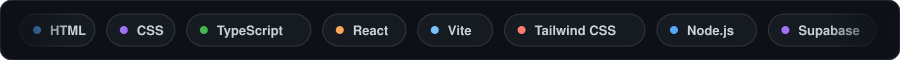

  
  
  

### Project pilihan

  
  
  

  
    Demo:
    <a href="https://e-gabah.vercel.app">E-Gabah</a> ·
    <a href="https://absenyura.vercel.app">absenyura</a> ·
    <a href="https://github.com/Korumisa/luxuryphotography">luxuryphotography</a> (Laravel)
  

### Aktivitas terbaru

  <picture>
    <source media="(prefers-color-scheme: dark)" srcset="assets/snake-dark.svg" />
    <source media="(prefers-color-scheme: light)" srcset="assets/snake.svg" />
    
  </picture>

### Guestbook

  

Pesan tampil setelah saya setujui.

### Statistik

  
  

  

